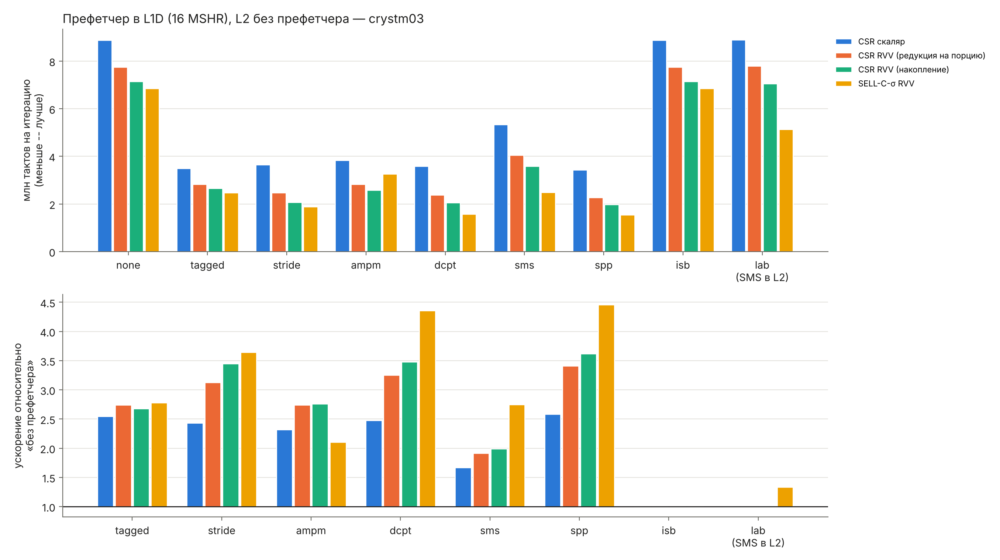
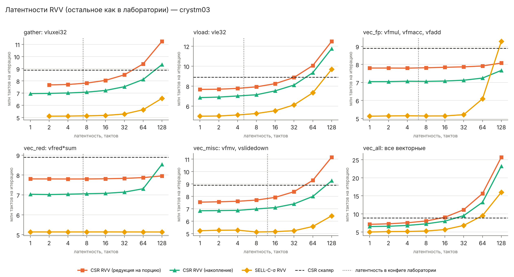

# Влияние префетчеров и латентностей векторных операций на SpMV (CSR и SELL-C-σ) в модели RISC-V RVV (gem5)

Промежуточный отчёт по дипломной работе, ноябрь 2026.
Маковеева С. И., группа 3823Б1ПР1, ННГУ. Научный руководитель: Козинов Е. А.

Все числа в отчёте взяты из файлов `results/*.csv` этого репозитория. Под каждой
таблицей указан файл-источник. Код бенчмарка, конфигурация gem5 и порядок
запуска описаны в [`README.md`](README.md).

## 1. Задача

1. Подобрать около шести аппаратных префетчеров и оценить, как каждый из них
   влияет на производительность умножения разреженной матрицы на вектор (SpMV).
2. Изменять латентности векторных операций RVV и найти, при каких латентностях
   быстрее векторный код, а при каких — скалярный.
3. Каждый запуск должен занимать немного времени.

## 2. Методика

### 2.1. Модель процессора

Используется конфигурация лаборатории (`gem5_board/binary_run.py`) без
изменений: gem5 24.1.0.2, форк ValentinV95/gem5, ветка `rvv_cross`,
коммит d01492dcd8; режим SE.

| Узел | Параметры |
|---|---|
| Ядро | O3 (внеочередное), 1,6 ГГц; ширина fetch 6, decode 2, issue 4, commit 6 |
| Векторное расширение | RVV 1.0, VLEN = 256 бит (8 чисел float в регистре) |
| L1I, L1D | по 32 КиБ, 4-way, 2+2+2 такта; L1D — 4 MSHR |
| L2 | 512 КиБ, 2-way, 40+40+40 тактов, 40 MSHR, префетчер SMS |
| Память | DDR4-2400 |
| Латентности RVV | загрузка `vle32` 5 тактов, `vluxei32` 7, `vfmul`/`vfmacc` 6, `vfadd` 5, редукции 7, SimdMisc (`vfmv`, `vmv`) 12 |

Скрипт `gem5/spmv_run.py` без параметров строит ту же систему, что и
`binary_run.py`. Это проверено: оба скрипта на одном бинарнике дают побайтно
одинаковый `config.ini` и одинаковую статистику (кроме служебных строк
`host*`). Параметры (префетчеры, латентности, размеры кэшей, число MSHR)
меняются только через командную строку, исходный код gem5 в основных сериях
не менялся.

### 2.2. Ядра SpMV

Вычисляется y = A·x для матрицы в формате float32.

| Ядро | Как считает |
|---|---|
| CSR скаляр | обычный цикл по строкам CSR |
| CSR RVV, редукция | строка обрабатывается порциями по 8 элементов: `vle32` значений и индексов, `vluxei32` (выборка x), `vfmul`, редукция `vfredosum` на каждую порцию (алгоритм прошлого семестра) |
| CSR RVV, накопление | произведения копятся в векторном регистре (`vfmacc`), одна редукция на строку |
| SELL-C-σ RVV | C = 8, σ = 64; каждая из 8 ячеек вектора считает свою строку (`vfmacc` без редукций), результат записывается по перестановке строк одной `vsuxei32` |

Сборка: `rvv-gcc` 13.2.0 (newlib), `-O2 -fno-tree-vectorize`. Флаг оставляет
скалярное ядро скалярным; при каждой сборке это проверяется по машинному коду.
Машинный код всех ядер сохранён в `results/kernels_*.asm`.

### 2.3. Матрицы (SuiteSparse)

| Матрица | n | nnz | nnz/строку | Элементов в SELL-8-64 | Доля дополнения | Данные CSR | Вектор x |
|---|---:|---:|---:|---:|---:|---:|---:|
| nasa2910 | 2 910 | 174 296 | 59,9 | 196 436 | +12,7 % | 1 373 КиБ | 11,4 КиБ |
| crystm03 | 24 696 | 583 770 | 23,6 | 602 040 | +3,1 % | 4 657 КиБ | 96,5 КиБ |

У обеих матриц данные не помещаются в L2 (512 КиБ). Вектор x у nasa2910
помещается в L1D (32 КиБ), у crystm03 не помещается.

### 2.4. Измерение

- Матрица в форматах CSR и SELL-C-σ строится заранее на компьютере (скрипт
  `tools/gen_bench_header.py`) и встраивается в программу как константы. Время
  перевода CSR → SELL-C-σ в замер не входит.
- Для каждого ядра выполняется 1 прогревочная итерация и 2 измеряемые. Вокруг
  них стоят маркеры `m5_dump_reset_stats`, поэтому такты, промахи кэшей и
  счётчики префетчеров берутся из статистики gem5 отдельно для каждого ядра.
  В таблицах приведены **такты на одну измеряемую итерацию**.
- После прогрева и после замера результат каждого ядра сравнивается с эталоном,
  посчитанным в double. Допуск для строки i: (nnz_i + 4)·2⁻²³·Σ|a_ij·x_j|.
  Запуски с неверным результатом помечаются `verified=False` и в выводы не входят.
- Все запуски сделаны на компьютере автора (WSL2, Ubuntu 24.04, 2 ядра).
  Один запуск gem5 длится около 44 с для nasa2910 и около 147 с для crystm03.
- gem5 детерминирован: при повторном прогоне серий `pf_l1d`, `pf_l2` и
  латентностей на nasa2910 такты совпали до такта.

### 2.5. Серии экспериментов

**Префетчеры.** В каждом запуске префетчер стоит только на одном уровне
кэша, на другом уровне префетчера нет:

- `pf_l1d`: префетчер в L1D (4 MSHR), L2 без префетчера;
- `pf_l2`: префетчер в L2, L1D без префетчера;
- `pf_l1d_mshr16`: префетчер в L1D при 16 MSHR, L2 без префетчера.

Префетчеры: tagged, stride, ampm, dcpt, sms, spp, isb. Все с параметрами gem5 по
умолчанию, SMS — с параметрами лаборатории. Для сравнения есть запуски
`none` (без префетчеров) и `lab` (конфигурация лаборатории: SMS в L2).
BOP и IMP в этой версии gem5 не работают (раздел 4) и в серии не входят.

**Латентности RVV.** Латентность одной группы операций принимает значения 1,
2, 4, 8, 16, 32, 64, 128 тактов, остальное — как в конфигурации лаборатории.

| Группа | Классы операций gem5 | Инструкции в ядрах | В лаборатории |
|---|---|---|---:|
| gather | SimdIndexedLoad | `vluxei32` | 7 |
| vload | SimdUnitStrideLoad | `vle32` | 5 |
| vec_fp | SimdFloatMult, SimdFloatMultAcc, SimdFloatAdd | `vfmul`, `vfmacc`, `vfadd` | 6, 6, 5 |
| vec_red | SimdFloatReduceAdd | `vfredosum`, `vfredusum` | 7 |
| vec_misc | SimdMisc | `vfmv.f.s`, `vfmv.v.f`, `vmv.v.i`, а также служебные микрооперации `vluxei32` (`vcpyvs`, `vpinvd`) | 12 |
| vec_all | все классы Simd* | все векторные | — |

**Размещение данных.** Ключевые конфигурации повторены с массивами матрицы,
выровненными по 64 и по 4096 байт (сборка `ALIGN=...`).

## 3. Результаты

### 3.1. Конфигурация лаборатории

| Матрица | Ядро | Тактов на итерацию | Время, мкс | Ускорение к CSR скаляр | Инструкций на итерацию |
|---|---|---:|---:|---:|---:|
| nasa2910 | CSR скаляр | 2 521 938,5 | 1 576 | 1,00 | 1 630 тыс. |
| nasa2910 | CSR RVV, редукция | 2 306 472 | 1 442 | 1,09 | 468 тыс. |
| nasa2910 | CSR RVV, накопление | 2 076 332,5 | 1 298 | 1,21 | 396 тыс. |
| nasa2910 | SELL-C-σ RVV | 1 520 849,5 | 951 | 1,66 | 234 тыс. |
| crystm03 | CSR скаляр | 8 898 876 | 5 562 | 1,00 | 5 773 тыс. |
| crystm03 | CSR RVV, редукция | 7 797 129 | 4 873 | 1,14 | 1 943 тыс. |
| crystm03 | CSR RVV, накопление | 7 053 195,5 | 4 408 | 1,26 | 1 759 тыс. |
| crystm03 | SELL-C-σ RVV | 5 140 515,5 | 3 213 | 1,73 | 698 тыс. |

<sub>Источник: `pf_l1d_<матрица>.csv`, запуск `lab`. Дробные такты — среднее по двум итерациям.</sub>

В конфигурации лаборатории все векторные ядра быстрее скалярного, быстрее
всех SELL-C-σ. Векторные ядра выполняют в 3–8 раз меньше инструкций, но
ускорение гораздо меньше, потому что время уходит на ожидание памяти: IPC
векторных ядер 0,14–0,25 против 0,65 у скалярного.

### 3.2. Префетчеры

В таблицах — тысячи тактов на итерацию, в скобках — ускорение относительно
**скалярного CSR без префетчера** той же матрицы.

**nasa2910**

| Префетчер | CSR скаляр | CSR RVV, редукция | CSR RVV, накопление | SELL-C-σ RVV |
|---|---:|---:|---:|---:|
| *L1D, 4 MSHR* | | | | |
| none | 2 531 (1,00) | 2 310 (1,10) | 2 076 (1,22) | 2 723 (0,93) |
| tagged | 1 803 (1,40) | 1 768 (1,43) | 1 758 (1,44) | 2 504 (1,01) |
| stride | 1 783 (1,42) | 1 753 (1,44) | 1 714 (1,48) | 2 475 (1,02) |
| ampm | 1 709 (1,48) | 1 615 (1,57) | 1 563 (1,62) | 2 231 (1,13) |
| dcpt | 1 721 (1,47) | 1 517 (1,67) | 1 434 (1,77) | 2 227 (1,14) |
| sms | 1 987 (1,27) | 1 556 (1,63) | 1 420 (1,78) | 1 850 (1,37) |
| spp | 1 788 (1,42) | 1 747 (1,45) | 1 729 (1,46) | 2 464 (1,03) |
| isb | 2 531 (1,00) | 2 310 (1,10) | 2 076 (1,22) | 2 723 (0,93) |
| *L2* | | | | |
| tagged | 1 261 (2,01) | 1 054 (2,40) | 839 (3,02) | 1 156 (2,19) |
| stride | 1 253 (2,02) | 1 050 (2,41) | 844 (3,00) | 897 (2,82) |
| ampm | 1 265 (2,00) | 1 063 (2,38) | 892 (2,84) | 1 050 (2,41) |
| dcpt | 1 283 (1,97) | 1 075 (2,36) | 900 (2,81) | 849 (2,98) |
| sms = lab | 2 522 (1,00) | 2 306 (1,10) | 2 076 (1,22) | 1 521 (1,66) |
| spp | 1 232 (2,05) | 1 052 (2,41) | 830 (3,05) | 826 (3,06) |
| *L1D, 16 MSHR* | | | | |
| tagged | 964 (2,62) | 832 (3,04) | 755 (3,35) | 1 236 (2,05) |
| stride | 960 (2,64) | 671 (3,77) | 556 (4,55) | 840 (3,01) |
| ampm | 1 070 (2,37) | 811 (3,12) | 703 (3,60) | 740 (3,42) |
| dcpt | 918 (2,76) | 635 (3,98) | 529 (4,78) | 540 (4,69) |
| sms | 1 682 (1,50) | 1 259 (2,01) | 1 076 (2,35) | 1 064 (2,38) |
| spp | 935 (2,71) | 649 (3,90) | **518 (4,88)** | 665 (3,81) |

<sub>Источники: `pf_l1d_nasa2910.csv`, `pf_l2_nasa2910.csv`, `pf_l1d_mshr16_nasa2910.csv`.
ISB в L2 и при 16 MSHR даёт те же такты, что none (строки опущены).</sub>

**crystm03**

| Префетчер | CSR скаляр | CSR RVV, редукция | CSR RVV, накопление | SELL-C-σ RVV |
|---|---:|---:|---:|---:|
| *L1D, 4 MSHR* | | | | |
| none | 8 884 (1,00) | 7 753 (1,15) | 7 141 (1,24) | 6 856 (1,30) |
| tagged | 6 301 (1,41) | 6 075 (1,46) | 6 000 (1,48) | 6 183 (1,44) |
| stride | 6 176 (1,44) | 5 941 (1,50) | 5 859 (1,52) | 6 100 (1,46) |
| ampm | 5 976 (1,49) | 5 444 (1,63) | 5 317 (1,67) | 5 313 (1,67) |
| dcpt | 5 963 (1,49) | 5 285 (1,68) | 5 102 (1,74) | 5 222 (1,70) |
| sms | 7 818 (1,14) | 6 835 (1,30) | 6 223 (1,43) | 4 956 (1,79) |
| spp | 5 961 (1,49) | 5 553 (1,60) | 5 283 (1,68) | 6 090 (1,46) |
| isb | 8 884 (1,00) | 7 753 (1,15) | 7 141 (1,24) | 6 856 (1,30) |
| *L2* | | | | |
| tagged | 4 458 (1,99) | 3 487 (2,55) | 3 100 (2,87) | 2 587 (3,43) |
| stride | 4 460 (1,99) | 3 488 (2,55) | 3 097 (2,87) | 2 579 (3,44) |
| ampm | 4 460 (1,99) | 3 622 (2,45) | 3 255 (2,73) | 2 873 (3,09) |
| dcpt | 4 590 (1,94) | 3 594 (2,47) | 3 288 (2,70) | 2 709 (3,28) |
| sms = lab | 8 899 (1,00) | 7 797 (1,14) | 7 053 (1,26) | 5 141 (1,73) |
| spp | 4 454 (1,99) | 3 498 (2,54) | 3 079 (2,89) | 2 599 (3,42) |
| *L1D, 16 MSHR* | | | | |
| tagged | 3 488 (2,55) | 2 824 (3,15) | 2 663 (3,34) | 2 468 (3,60) |
| stride | 3 649 (2,43) | 2 477 (3,59) | 2 071 (4,29) | 1 883 (4,72) |
| ampm | 3 828 (2,32) | 2 828 (3,14) | 2 589 (3,43) | 3 261 (2,72) |
| dcpt | 3 587 (2,48) | 2 384 (3,73) | 2 052 (4,33) | 1 573 (5,65) |
| sms | 5 331 (1,67) | 4 046 (2,20) | 3 593 (2,47) | 2 493 (3,56) |
| spp | 3 436 (2,59) | 2 272 (3,91) | 1 975 (4,50) | **1 538 (5,78)** |

<sub>Источники: `pf_l1d_crystm03.csv`, `pf_l2_crystm03.csv`, `pf_l1d_mshr16_crystm03.csv`.
ISB в L2 и при 16 MSHR даёт те же такты, что none (строки опущены).</sub>

Графики: `results/fig_pf_l1d_*.png`, `results/fig_pf_l2_*.png`,
`results/fig_pf_l1d_mshr16_*.png`.



**Наблюдения**

1. **Лучший префетчер в L2 ускоряет каждое ядро в 2,0–3,3 раза** по сравнению
   с тем же ядром без префетчера. Лучшие префетчеры в L2 — stride, spp и
   tagged, для SELL-C-σ на nasa2910 ещё и dcpt. Для CSR они отличаются не
   больше чем на 4 %.
2. **В L1D при 4 MSHR префетчеры дают заметно меньше**, а SELL-C-σ на nasa2910
   с ними медленнее скалярного CSR с тем же префетчером (кроме SMS). gem5 отправляет запрос
   префетчера, только если нет ожидающих обычных промахов и занято меньше
   `mshrs − 2` регистров промаха (`BaseCache::getNextQueueEntry`,
   `MSHRQueue::canPrefetch`). В L1D с 4 MSHR это значит «занято меньше двух».
   Покрытие промахов SELL-C-σ префетчерами в L1D при 4 MSHR: на nasa2910
   4–17 % (stride, dcpt, spp, tagged), на crystm03 18–36 %.
3. **При 16 MSHR в L1D те же префетчеры становятся лучшими во всём
   эксперименте.** Покрытие SELL-C-σ вырастает до 87–96 %. Без префетчера
   число MSHR такты почти не меняет (nasa2910: 2 531 и 2 531 тыс., crystm03:
   8 884 и 8 884 тыс. у скалярного CSR). Лучшие результаты:
   - nasa2910: CSR RVV с накоплением и SPP — 518 тыс. тактов, в 4,9 раза
     быстрее скалярного CSR без префетчера;
   - crystm03: SELL-C-σ и SPP — 1 538 тыс. тактов, в 5,8 раза быстрее.
4. **Префетчеры не уменьшают объём данных, а прячут задержку.** Из памяти за
   итерацию читается почти одно и то же во всех запусках серий префетчеров:
   nasa2910 — 1 395–1 402 КиБ у CSR и 1 578–1 604 КиБ у SELL-C-σ, crystm03 —
   4 867–4 908 и 5 014–5 047 КиБ (`dram_bytes_read`). Это объём данных
   матрицы; у SELL-C-σ он больше на долю дополнения.
5. **SMS в конфигурации лаборатории** на nasa2910 почти не работает для CSR:
   около 270 запросов за итерацию (без префетчера у CSR 22 324 промаха L2 за
   итерацию), покрытие 1 %. Для SELL-C-σ покрытие 70 %, поэтому в конфигурации
   лаборатории ускоряется в основном SELL-C-σ. На crystm03 покрытие SMS: 26 % для CSR, 50 % для SELL-C-σ.
6. **ISB** не дал эффекта ни в одной конфигурации: такты равны запуску без
   префетчера. Причина не исследовалась.
7. **«Точность» (`accuracy`) в gem5** считается как полезные / выданные, где в
   выданные входят и отброшенные запросы, чья строка уже была в кэше
   (`pfLate`). Доля полезных среди реально отправленных:
   полезные / (выданные − pfLate). Например, в L2 для SELL-C-σ на nasa2910 она
   равна 0,98 у SPP и 0,64 у tagged; поэтому tagged здесь медленнее.

### 3.3. Латентности векторных операций

Наибольшая из проверенных латентностей, при которой векторное ядро ещё быстрее
скалярного CSR (конфигурация лаборатории, SMS в L2). «≥128» — быстрее при всех
проверенных значениях. Точка, где векторное ядро становится медленнее, лежит
между указанным значением и следующим вдвое большим.

| Группа | nasa2910: редукция | накопление | SELL-C-σ | crystm03: редукция | накопление | SELL-C-σ |
|---|---:|---:|---:|---:|---:|---:|
| gather (`vluxei32`) | 16 | ≥128 | ≥128 | 32 | 64 | ≥128 |
| vload (`vle32`) | 16 | 32 | 64 | 32 | 32 | 64 |
| vec_fp | ≥128 | ≥128 | 64 | ≥128 | ≥128 | 64 |
| vec_red | ≥128 | ≥128 | ≥128 | ≥128 | ≥128 | ≥128 |
| vec_misc | 32 | ≥128 | ≥128 | 32 | 64 | ≥128 |
| **vec_all** | **8** | **16** | **32** | **8** | **16** | **32** |

<sub>Источники: `lat_nasa2910.csv`, `lat_crystm03.csv`. Точки `gather_1` для CSR RVV с
редукцией и SELL-C-σ исключены (неверный результат, раздел 4).</sub>

| Ускорение к CSR скаляр | nasa2910: редукция | накопление | SELL-C-σ | crystm03: редукция | накопление | SELL-C-σ |
|---|---:|---:|---:|---:|---:|---:|
| все векторные — 1 такт | 1,22 | 1,28 | 1,70 | 1,25 | 1,37 | 1,78 |
| как в лаборатории | 1,09 | 1,21 | 1,66 | 1,14 | 1,26 | 1,73 |
| все векторные — 128 тактов | 0,31 | 0,45 | 0,51 | 0,35 | 0,38 | 0,56 |



**Наблюдения**

1. Если замедлять все векторные операции сразу, пороги на обеих матрицах
   одинаковы: векторный CSR с редукцией быстрее скалярного до 8 тактов, с
   накоплением до 16, SELL-C-σ до 32.
2. Латентности лаборатории (5–12 тактов) лежат там, где все векторные ядра
   быстрее скалярного.
3. Латентность редукций почти не влияет даже на CSR RVV с редукцией на каждую
   порцию: при 128 тактах ускорение не опускается ниже 1,09 (nasa2910).
4. CSR RVV с редукцией чувствительнее остальных к латентности загрузок
   (`vle32`, `vluxei32`) и SimdMisc; в SimdMisc входят и служебные
   микрооперации `vluxei32`. SELL-C-σ, наоборот, чувствительнее CSR к
   латентности `vfmacc` (группа vec_fp). Причина этого различия отдельно не
   исследовалась.
5. Даже при латентности 1 такт для всех векторных операций ускорение не
   превышает 1,78: ядра ограничены памятью.
6. Такты скалярного CSR одинаковы во всех 49 запусках серии (2 521 938,5 и
   8 898 876): латентности векторных операций на скалярный код не влияют.

### 3.4. Зависимость от размещения данных в памяти

Разброс тактов между вариантами выравнивания массивов (nasa2910 — без
выравнивания, по 64 и по 4096 байт; crystm03 — без выравнивания и по 4096).

| Конфигурация | nasa2910 | crystm03 |
|---|---|---|
| без префетчера | до 5 % | до 4 % |
| stride, spp (L1D и L2) | до 5 % | spp — до 4 % (stride не проверялся) |
| dcpt, SELL-C-σ | L2 — 21 %, L1D 16 MSHR — 15 % | до 4 % |
| лаборатория (SMS в L2) | CSR RVV — 21–23 %, SELL-C-σ — 16 % | SELL-C-σ — 8 % |

<sub>Источники: `pf_*_nasa2910{,_a64,_a4096}.csv`, `pf_*_crystm03{,_a4096}.csv`.</sub>

Лучшие результаты из раздела 3.2 устойчивы к размещению: nasa2910, CSR RVV
с накоплением и SPP при 16 MSHR — 497–519 тыс. тактов; crystm03, SELL-C-σ и
SPP при 16 MSHR — 1 475–1 538 тыс. А результаты с SMS (конфигурация
лаборатории) и с DCPT для SELL-C-σ на nasa2910 зависят от адресов массивов на
15–23 %, поэтому их нужно приводить диапазоном.

### 3.5. SELL-C-σ и векторный CSR на двух матрицах

На crystm03 SELL-C-σ быстрее векторного CSR без префетчера, в конфигурации
лаборатории, со всеми префетчерами в L2 и со всеми при 16 MSHR, кроме AMPM.
С префетчером в L1D при 4 MSHR он быстрее только с SMS (с AMPM — вровень).
На nasa2910 они близки: в L2 со SPP 826 и 830 тыс. тактов, а при 16 MSHR CSR RVV с накоплением быстрее (518 тыс.
против 540 тыс. у лучшего варианта SELL-C-σ). Без префетчеров на nasa2910
SELL-C-σ медленнее даже скалярного CSR (0,93), на crystm03 быстрее (1,30).

| Матрица | Инструкций на элемент: CSR RVV, накопление | SELL-C-σ | Отношение | Лишние данные SELL-C-σ |
|---|---:|---:|---:|---:|
| nasa2910 (59,9 элемента в строке) | 2,27 | 1,34 | 1,7 | +13 % |
| crystm03 (23,6 элемента в строке) | 3,01 | 1,20 | 2,5 | +3 % |

<sub>Источник: `pf_l1d_<матрица>.csv`, запуск `none`, `insts` / `nnz` (инструкции без
разбиения на микрооперации) и `dram_bytes_read`.</sub>

Это согласуется с гипотезой: при коротких строках векторный CSR тратит больше
инструкций на элемент (больше неполных порций и редукций), а SELL-C-σ этого
не делает и к тому же почти не тратит память на дополнение. При длинных
строках nasa2910 разница в инструкциях меньше, а лишние 13 % данных SELL-C-σ
ощутимы. Чтобы утверждать это уверенно, нужны ещё матрицы с разной длиной
строк.

## 4. Найденные проблемы gem5

1. **BOP (Best-Offset) не выдаёт ни одного запроса** (`pfIssued = 0`;
   проверено при разработке набора на той же версии gem5). В
   `BOP::bestOffsetLearning` полный адрес сравнивается с тегами строк, и
   обучение не находит смещение. В ветке develop gem5 эта строка исправлена.
2. **IMP (Indirect Memory Prefetcher) останавливает симуляцию** с
   `panic: PrefetchInfo::get called with a request with no data`.

   Для обоих есть патч `gem5_patches/prefetch_bop_imp.patch`. В приведённых
   результатах он не применялся.
3. **Неверный результат при латентности `vluxei32` = 1 такт.** gem5 разбивает
   `vluxei32` на микрооперации: `vcpyvs` (копия индексов), `vpinvd` (регистр-
   приёмник заполняется единицами и закрепляется) и 8 загрузок по одной на
   элемент. Загрузки не зависят от `vpinvd`, и если первая из них закончится
   раньше, `vpinvd` затирает загруженный элемент значением 0xFFFFFFFF (NaN).
   Это показано трассировкой (`--debug-flags=ExecAll,O3PipeView`); подробности
   в README. В конфигурации лаборатории (SimdMisc 12 тактов, загрузки 7)
   гонка не возникает. Потерянный элемент всегда даёт NaN, и проверка
   результата такие запуски ловит. Неверные точки — только `gather_1`
   (на обеих матрицах), они исключены.

## 5. Ограничения

- Это модель процессора в gem5, а не реальная аппаратура.
- Проверена одна длина вектора (VLEN = 256) и две матрицы.
- Параметры префетчеров — по умолчанию gem5; их настройка могла бы изменить
  порядок.
- Время перевода матрицы в SELL-C-σ в замер не входит.
- Часть результатов зависит от размещения данных на 15–23 % (раздел 3.4).
- Эффект ISB и низкое покрытие SMS для CSR на nasa2910 не объяснены.
- BOP и IMP не измерены (ошибки gem5, раздел 4).
- Измерения прошлого лета (сборка `-O0`, другой код ядер, время по
  `std::chrono`) с этими не сравнимы и заменяются ими.

## 6. Выводы

1. В конфигурации лаборатории все три векторных ядра быстрее скалярного CSR;
   быстрее всех SELL-C-σ: в 1,66 раза на nasa2910 и в 1,73 раза на crystm03.
2. SpMV в этой модели ограничен памятью: векторные ядра выполняют в 3–8 раз
   меньше инструкций, но даже при латентности векторных операций 1 такт
   ускорение не выше 1,78.
3. Аппаратный префетчер даёт больше, чем векторизация: лучший префетчер в L2
   ускоряет каждое ядро в 2,0–3,3 раза.
4. В L1D лабораторной конфигурации префетчерам мешает малое число MSHR (4):
   с 16 MSHR префетчер в L1D даёт лучшие результаты эксперимента — до 4,9
   (nasa2910) и 5,8 раза (crystm03) относительно скалярного CSR без
   префетчера. Лучшие префетчеры — SPP и DCPT.
5. Векторный код быстрее скалярного, пока латентность всех векторных операций
   не превышает 8 тактов (CSR с редукцией), 16 (CSR с накоплением) и 32
   (SELL-C-σ) на обеих матрицах. На векторный CSR сильнее всего влияют
   латентности загрузок; у SELL-C-σ порог для `vle32` и для `vfmacc` одинаковый
   (64 такта); латентность редукций почти не влияет.
6. Преимущество SELL-C-σ над векторным CSR зависит от матрицы: на crystm03
   (короткие строки, 3 % дополнения) оно есть почти во всех конфигурациях,
   кроме префетчеров в L1D при 4 MSHR. На nasa2910 (длинные строки, 13 %
   дополнения) SELL-C-σ устойчиво быстрее векторного CSR только в
   конфигурации лаборатории; с лучшими префетчерами в L2 они на одном уровне,
   а при 16 MSHR CSR с накоплением быстрее.

## 7. Возможное продолжение

- Больше матриц с разной длиной строк, чтобы проверить гипотезу раздела 3.5.
- Перебор числа MSHR в L1D (4, 8, 16, 32) и размера L2.
- Другие длины вектора (VLEN = 128, 512).
- BOP и IMP с патчем; разбор ISB и SMS.
- Настройка параметров лучших префетчеров (SPP, DCPT).

## 8. Как воспроизвести

```bash
cd diploma
scripts/build.sh nasa2910 crystm03
scripts/run_prefetchers.sh nasa2910;  scripts/run_prefetchers.sh nasa2910 l2
TAG=_mshr16 EXTRA="--l1d-mshrs 16" scripts/run_prefetchers.sh nasa2910
scripts/run_latency.sh nasa2910
# то же для crystm03; размещение данных: README, шаг 3в
scripts/parse_all.sh
```

Подробно — в [`README.md`](README.md). Использованы gem5 d01492dcd8
(ValentinV95/gem5, `rvv_cross`) и `rvv-gcc` 13.2.0.
